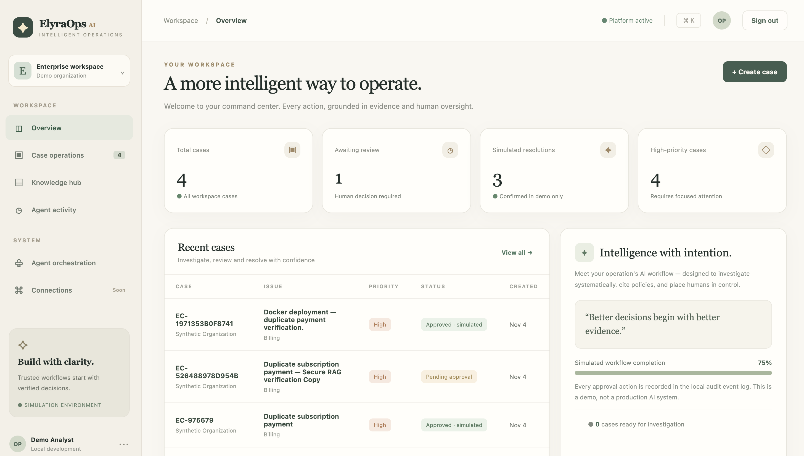
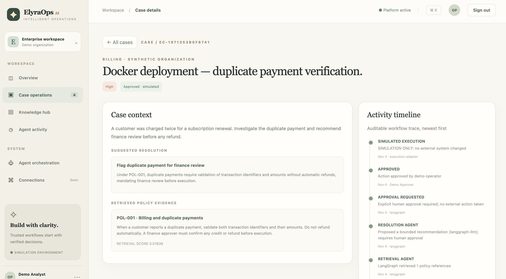
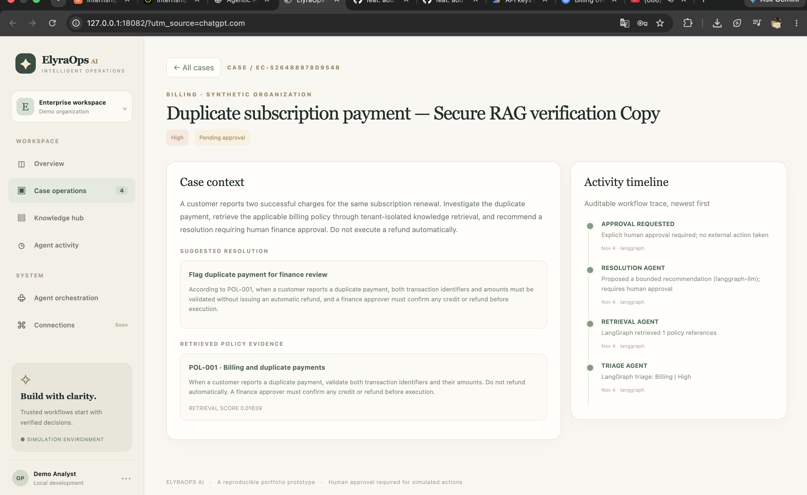
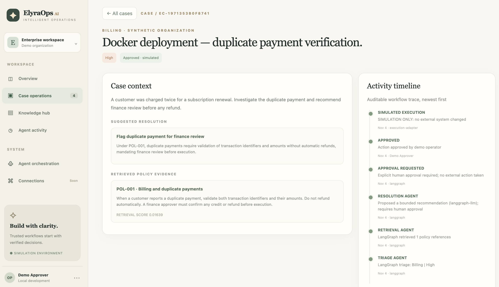
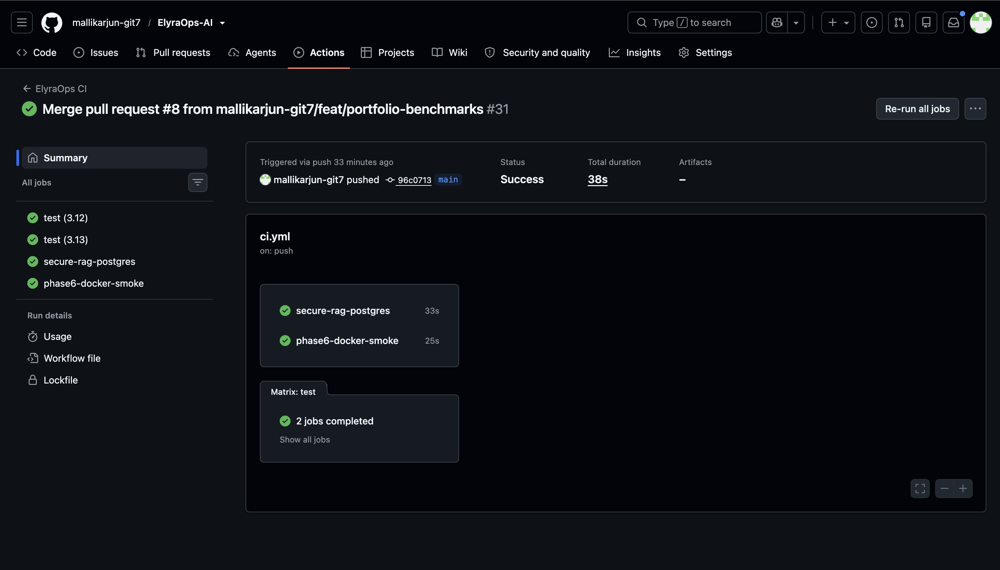
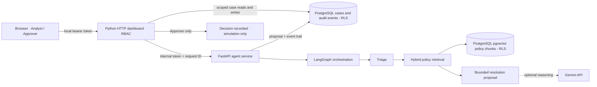

<div align="center">

# ✦ ElyraOps AI

### Evidence-first incident investigation · Agentic AI · Human-controlled decisions

**An enterprise-style operations workbench that turns a synthetic incident into a traceable, policy-grounded recommendation — without taking an unapproved real-world action.**

<p>
  <a href="https://github.com/mallikarjun-git7/ElyraOps-AI/actions/workflows/ci.yml"></a>
  
  
  
</p>

[**Explore the screenshots**](#application-showcase) · [**Understand the architecture**](#system-architecture) · [**Follow a case**](#how-an-investigation-works) · [**Run locally**](#run-elyraops-locally) · [**Review the evidence**](#testing--engineering-evidence)

</div>

---

## The problem

Operational incidents are rarely just a question of *what happened?* Teams also need to know **which policy applies**, **why an action is recommended**, **who has authority to approve it**, and **what was recorded afterward**.

**ElyraOps AI** explores that problem through a working, localhost-only demonstration. Analysts open synthetic incidents, a LangGraph workflow performs triage and policy retrieval, and a bounded resolution proposal is routed to a separate human approver. The application records the decision and its event trail; any "execution" is **simulated**.

> **Designed as a portfolio engineering prototype.** The guarded Docker workflow, RAG retrieval, PostgreSQL tenant scoping and CI are implemented and tested. This is **not** a cloud-hosted production SaaS, a real payment processor or an autonomous agent permitted to change external systems.

## At a glance

| Question | Answer |
| --- | --- |
| **What does it do?** | Investigates synthetic operations cases, retrieves relevant policies, suggests a controlled resolution and records human decisions. |
| **What makes it agentic?** | A LangGraph sequence coordinates triage → retrieval → resolution planning, with optional Gemini-backed explanation. |
| **Where does the knowledge come from?** | Tenant-scoped PostgreSQL full-text + pgvector hybrid retrieval, with cited policy excerpts. |
| **Where is state stored?** | PostgreSQL case records and audit events in guarded mode; local SQLite paths support the standalone deterministic demo. |
| **Who can approve?** | An authorized **Approver** role, not an Analyst. Approval produces a simulated outcome only. |
| **How can it be evaluated?** | Five real screenshots, a reproducible local demo, CI checks, architecture notes and a narrowly scoped k6 report. |

## Technology stack

Each badge links to the technology used in the repository; the stack describes **implemented components**, not aspirational roadmap items.

**Backend & orchestration**

[](https://www.python.org/)
[](https://fastapi.tiangolo.com/)
[](https://github.com/langchain-ai/langgraph)
[](#http-surfaces)

**AI, search & persistence**

[](https://ai.google.dev/)
[](https://www.postgresql.org/)
[](https://github.com/pgvector/pgvector)
[](https://www.sqlite.org/)

**Interface & delivery**

[](https://developer.mozilla.org/en-US/docs/Web/JavaScript)
[](https://developer.mozilla.org/en-US/docs/Web/HTML)
[](https://developer.mozilla.org/en-US/docs/Web/CSS)
[](https://www.docker.com/)
[](https://github.com/features/actions)
[](https://grafana.com/docs/k6/)

**Engineering concepts:** `RAG` · `RBAC` · `PostgreSQL RLS` · `tenant-scoped queries` · `reciprocal rank fusion` · `request IDs` · `idempotent investigation` · `human-in-the-loop` · `structured logs` · `Docker health checks`.

---

## Application showcase

All five images below are **actual screenshots captured from the running ElyraOps AI demonstration** or its GitHub CI, using synthetic data. They are stored in this repository and do not depend on an external image host.

### 01 — Operations at a glance

A unified workspace for case volume, review status, recent investigations and simulated outcomes.



### 02 — Investigation grounded in policy

A Billing case shows the proposed finance-review resolution, the retrieved **POL-001** policy and the agent activity timeline.



### 03 — Human approval is a separate step

The Analyst can investigate and propose a resolution, but cannot independently authorize it.



### 04 — Decision recorded; external action not executed

An Approver records **Approved · simulated**; the activity timeline shows the investigation and decision trail.



### 05 — CI evidence

The GitHub Actions workflow verifies Python test matrices, PostgreSQL RLS integration and Docker smoke checks.



For the screenshot capture criteria, see [SCREENSHOTS.md](docs/portfolio/SCREENSHOTS.md).

---

## How an investigation works

**Example: a customer reports two subscription charges.** This is a *synthetic* Billing case and represents the verified local demo flow.

| Stage | Component | What happens | Evidence or control |
| --- | --- | --- | --- |
| **1. Authenticate** | Dashboard + local RBAC | An Analyst signs into a specific demo organization. | Browser token maps to a local role and organization. |
| **2. Create case** | Dashboard + PostgreSQL | The incident is saved with domain, priority, description and status. | Tenant-scoped case storage in guarded mode. |
| **3. Triage** | LangGraph | The agent workflow examines the case and classifies its operational context. | Triage event in the timeline. |
| **4. Retrieve policy** | PostgreSQL + pgvector | Hybrid lexical/vector search returns relevant policy chunks. | For duplicate payments, **POL-001** is cited. |
| **5. Propose action** | LangGraph + optional Gemini | A bounded recommendation is prepared: validate transactions and send for finance review. | Explanation and retrieved evidence appear in the case. |
| **6. Request approval** | Case workflow | Status changes to **Pending approval**. | No real refund or external business action occurs. |
| **7. Human decision** | Approver role | An authorized user chooses the simulated decision. | **Approved · simulated** and audit events are recorded. |

**What the system deliberately refuses to do:** automatically issue a refund or treat model output as authorization. The recommendation is not the decision, and the decision is not an external payment instruction.

### A concrete policy example

> **POL-001 · Billing and duplicate payments** — verify transaction identifiers and amounts, and obtain finance approval before any credit or refund.

In the demonstration, the policy excerpt is displayed alongside the recommendation so a reviewer can inspect the basis for the proposed resolution rather than relying on an unexplained AI response.

## System architecture



**Trust boundaries matter.** The dashboard is published only on the local loopback interface. The FastAPI agent runs behind the Compose network rather than on a publicly published agent port. The guarded application uses a non-owner PostgreSQL runtime role and tenant-scoped `RLS` policies; local credentials and the Docker daemon are assumed trusted.

The full component breakdown, request sequence and security assumptions are in [docs/portfolio/ARCHITECTURE.md](docs/portfolio/ARCHITECTURE.md).

### Engineering decisions worth discussing

| Design choice | Why it exists | Trade-off |
| --- | --- | --- |
| **LangGraph stage separation** | Makes triage, retrieval and resolution individually visible in the event trail. | This demo does not implement durable, distributed workflow checkpoints. |
| **Hybrid full-text + pgvector search** | Combines lexical matches with semantic similarity; rank fusion merges candidates. | Retrieval quality is not backed by a published held-out evaluation benchmark. |
| **Database-level RLS** | Adds enforcement below API-level organization filters for cases/events and protected RAG rows. | Demo identity is not enterprise OIDC, and compromised privileged credentials remain out of scope. |
| **Human approval gate** | Keeps consequential decisions separate from agent recommendations. | All downstream execution is intentionally simulated. |
| **Structured logs and request IDs** | Supports tracing requests across the dashboard and agent. | There is no production distributed tracing collector or SLO. |
| **Local Compose + CI** | Makes the demo repeatable and verifies startup/security behavior in automated checks. | No public cloud deployment, autoscaling or managed secret service is claimed. |

## Security model

| Role | Read cases | Create & investigate | Approve simulation |
| --- | :---: | :---: | :---: |
| Viewer | ✓ | — | — |
| Analyst | ✓ | ✓ | — |
| Approver | ✓ | — | ✓ |
| Admin | ✓ | ✓ | ✓ |

Role permissions are combined with organization-scoped access in the guarded demo. The PostgreSQL runtime role enforces RLS on persisted case/event records and secured RAG chunks. Shared policy records are available only under the configured authenticated-tenant access rules.

**Security boundaries:** these are local bearer tokens, not OIDC, MFA or production SSO. There is no managed secret rotation, public ingress, independent penetration test or guarantee against a compromised database administrator. **Use synthetic information only.** See [security and scope limitations](docs/portfolio/LIMITATIONS.md).

## Run ElyraOps locally

### Option A — Quick standalone simulation

For exploring the interface and deterministic local workflow without setting up external services:

```bash
# From the repository root; Python 3.10+ is sufficient for this standalone path
python3 -m elyraops.server
```

Open **http://127.0.0.1:8080**. This unguarded standalone mode uses local SQLite-backed demonstration paths. **It does not demonstrate the secure PostgreSQL tenant-RLS deployment.**

### Option B — Guarded Docker + PostgreSQL + LangGraph demo

Prerequisites: Docker Desktop, prior local PostgreSQL/pgvector setup, the database's non-owner RLS roles/policies, and private `.env.security` and `.env.rls` configuration generated during the documented setup phases. A privately configured Gemini API key is needed for the live semantic/LLM investigation demonstration.

```bash
# Start the existing database and the two local application services
bash scripts/phase6_local.sh up

# Verify authenticated access guard and service readiness
bash scripts/phase6_local.sh check
```

Open **http://127.0.0.1:18082** and sign in using the privately generated **Analyst** token (not the internal agent token). Create a synthetic Billing case; investigate; inspect `POL-001`; then sign in as **Approver** to record an approved simulation.

```bash
# Inspect services without printing your secret configuration
bash scripts/phase6_local.sh ps

# Stop only the Phase 6 application containers (preserves PostgreSQL volume)
bash scripts/phase6_local.sh down
```

**Do not** commit `.env.*` files, publish ports beyond loopback, or run `docker compose down -v` against the database volume. The guarded installation is an **incremental local setup**, not a one-command production deployment from a pristine clone.

Detailed instructions: [deployment guide](DEPLOYMENT_PHASE6.md) · [tenant storage and RLS](POSTGRES_RLS_PHASE3B.md) · [secured RAG setup](SECURE_RAG_PHASE4.md) · [2–3 minute walkthrough](docs/portfolio/DEMO.md).

### HTTP surfaces

| Service | Route | Purpose |
| --- | --- | --- |
| Dashboard | `GET /health` | Dashboard liveness |
| Dashboard | `GET /api/auth/config` | Demo authentication configuration status |
| Dashboard | `GET /api/cases` | List permitted cases |
| Dashboard | `POST /api/cases` | Create a synthetic case with appropriate role |
| Dashboard | `POST /api/cases/{case_id}/investigate` | Start an authorized investigation |
| Dashboard | `POST /api/cases/{case_id}/decision` | Record an authorized simulated decision |
| Agent | `GET /health`, `GET /ready` | Liveness and dependency readiness |
| Agent | `POST /v1/investigate` | Internal authenticated LangGraph investigation |
| Both | `GET /metrics` | Internal-token-protected Prometheus-format metrics |

## Testing & engineering evidence

### Automated checks

The repository's GitHub Actions pipeline verifies:

- **Python 3.12 and 3.13:** unit/regression test matrix.
- **PostgreSQL RLS:** disposable pgvector database with live cross-tenant security assertions.
- **Docker smoke:** image build, container startup, request correlation and health/readiness checks without private API keys.

[](https://github.com/mallikarjun-git7/ElyraOps-AI/actions/workflows/ci.yml) · [View workflow history](https://github.com/mallikarjun-git7/ElyraOps-AI/actions)

```bash
# Offline tests: use an unconfigured shell / unset guarded local runtime values
python -m unittest discover -s tests -v
python -m compileall -q elyraops agent_service
```

The CI security integration tests are separate from the offline test matrix, and live Gemini calls are intentionally optional.

### Measured local HTTP benchmark

A **single read-only k6 run** against the Docker dashboard's `GET /health` and `GET /api/auth/config` endpoints produced:

| Metric | Measured value |
| --- | ---: |
| Load | **5 virtual users · 20 seconds** |
| HTTP requests | **550** |
| Failed requests | **0.00%** |
| Successful checks | **100.00%** |
| Median HTTP latency | **5.98 ms** |
| p90 latency | **10.76 ms** |
| p95 latency | **12.04 ms** |
| Maximum latency | **15.95 ms** |

The source report records **k6 v2.3.0**, a local Docker Desktop environment, no recorded warmup and source commit `d535fb7`. These figures **do not** measure Gemini inference, RAG retrieval, SQL throughput, complete investigations or production capacity. No production latency guarantee or before/after speedup is claimed.

[**Measured report**](docs/portfolio/MEASURED_RESULTS.md) · [**Benchmark protocol**](docs/portfolio/BENCHMARKS.md) · [**k6 workload**](load/k6_portfolio.js)

## Repository map

```text
ElyraOps-AI/
├── agent_service/             # FastAPI, LangGraph and policy retrieval
├── elyraops/                  # Dashboard HTTP service, cases and authorization
├── web/                       # Responsive browser interface
├── docs/portfolio/            # Architecture, walkthrough, benchmarks, images
│   └── screenshots/           # Five authentic application / CI screenshots
├── tests/                     # Offline tests and RLS regression coverage
├── load/                      # Read-only k6 smoke workloads
├── scripts/                   # Setup, local deployment and validation helpers
├── Dockerfile.phase6          # Non-root Python image
├── compose.phase6.yml         # Guarded local Compose deployment
└── .github/workflows/ci.yml   # Python + database + Docker checks
```

## Where to explore next

| Resource | What you'll find |
| --- | --- |
| [Architecture](docs/portfolio/ARCHITECTURE.md) | Component ownership, trust boundaries and request flow |
| [Demo script](docs/portfolio/DEMO.md) | Reproducible 2–3 minute case walkthrough |
| [Screenshot guide](docs/portfolio/SCREENSHOTS.md) | Authentic capture checklist and privacy precautions |
| [Measured benchmark](docs/portfolio/MEASURED_RESULTS.md) | Actual HTTP metrics and explicit workload limits |
| [Security limitations](docs/portfolio/LIMITATIONS.md) | Implemented safeguards versus production gaps |
| [Engineering decision history](ARCHITECTURE.md) | Earlier design rationale and trade-offs |
| [Source provenance](ORIGINS.md) | Reference attribution and upstream license policy |

---

<div align="center">

**ElyraOps AI — evidence before action, human approval before execution.**

*Built to demonstrate explainable agent workflows, secure backend boundaries, reproducible testing and an audit-friendly user experience — on synthetic data.*

</div>
