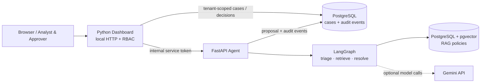

# ElyraOps AI

**Enterprise-style agentic operations prototype — a localhost-only, approval-gated demonstration.**

ElyraOps AI turns a *synthetic* incident into a traceable recommendation: classify the case, retrieve relevant policy evidence, prepare a bounded resolution with LangGraph and optionally Gemini, and require a human decision before recording a **simulated** execution. It never issues a payment/refund, changes a real business system, or processes real customer data.

**[Architecture](docs/portfolio/ARCHITECTURE.md) · [2-minute demo](docs/portfolio/DEMO.md) · [Benchmark protocol](docs/portfolio/BENCHMARKS.md) · [Screenshots checklist](docs/portfolio/SCREENSHOTS.md) · [Limitations](docs/portfolio/LIMITATIONS.md)**

## What is implemented

| Layer | Verified implementation |
| --- | --- |
| User experience | Responsive HTML/CSS/JavaScript dashboard: incidents, policies, activity timeline, sign-in and simulated approvals |
| API / orchestration | Python HTTP dashboard, FastAPI agent service, LangGraph triage → retrieval → resolution |
| LLM | Gemini-backed, policy-grounded rationale when a private API key is supplied; deterministic offline mode exists |
| Search | Hybrid PostgreSQL full-text + pgvector semantic search, rank fusion, evidence citations, domain filters |
| Persistence | PostgreSQL cases and audit events; separate policy-vector table; local SQLite supports deterministic demo/knowledge paths |
| Security demonstration | Local bearer-token roles, organization-scoped access, non-owner PostgreSQL runtime roles and enforced RLS on cases/events and RAG documents |
| Reliability | Health/readiness endpoints, JSON request logs, correlation IDs, protected Prometheus-format metrics and bounded agent timeouts |
| Deployment and CI | Local Docker Compose, non-root images, health checks, Python 3.12/3.13 tests, real PostgreSQL RLS CI and container smoke CI |

See the [project architecture](docs/portfolio/ARCHITECTURE.md) for which component owns each action and where trust boundaries remain.

## See the workflow

1. Sign in as **Analyst** to the guarded local demo.
2. Create a synthetic Billing case describing a duplicate subscription charge.
3. Run the LangGraph investigation. Inspect retrieved **POL-001** evidence and the suggested finance-review action.
4. Observe **Pending approval**. The Analyst cannot approve the case.
5. Sign in as **Approver**, select **Approve simulation**, and inspect the recorded audit events. **No external refund is executed.**

These steps were exercised with a local Docker deployment. Reproduce them using [DEMO.md](docs/portfolio/DEMO.md), which also describes screenshots and security precautions.

## Application screenshots

Real screenshots captured from the localhost-only ElyraOps AI demonstration using synthetic incident data.

| Operations dashboard | Billing investigation |
|:---:|:---:|
|  |  |

| Pending human approval | Approved simulation and audit trail |
|:---:|:---:|
|  |  |

### Continuous integration


The screenshots represent a local demonstration. No real financial action is executed.

## Run it yourself (localhost only)

Prerequisites: Docker Desktop; an existing initialized local pgvector/PostgreSQL container and its Phase 3/4 tenant-RLS roles; the ignored `.env.security` and `.env.rls` generated by the repository's earlier setup; a Gemini API key for real semantic/LLM investigation.

```bash
# Only after completing the earlier local security + PostgreSQL setup:
bash scripts/phase6_local.sh up
bash scripts/phase6_local.sh check
```

Open **http://127.0.0.1:18082**. Use a local Analyst token from your private `.env.login-tokens` file. The Docker agent is not publicly exposed. The helper reuses your existing database volume; **do not use `docker compose down -v`**.

For a simpler, unguarded deterministic simulation, `python3 -m elyraops.server` starts the standalone dashboard at `http://127.0.0.1:8080` with no Gemini dependency. This mode does *not* demonstrate PostgreSQL tenant isolation. Detailed setup is documented in [DEPLOYMENT_PHASE6.md](DEPLOYMENT_PHASE6.md), [SECURE_RAG_PHASE4.md](SECURE_RAG_PHASE4.md) and [POSTGRES_RLS_PHASE3B.md](POSTGRES_RLS_PHASE3B.md).

## Tests and engineering evidence

```bash
python -m unittest discover -s tests -v
python -m compileall -q elyraops agent_service
```

The CI workflow independently checks Python 3.12 and 3.13, disposable PostgreSQL RLS integration, and both Docker services' HTTP readiness. Live Gemini integration requires a private API key and is intentionally optional.

**Performance claims must be measured, not assumed.** The local k6 portfolio smoke probes only **GET /health** and **GET /api/auth/config** on the Docker dashboard. It is **not a database, agent/LLM, vector-search, or end-to-end workload benchmark**. The [benchmark protocol](docs/portfolio/BENCHMARKS.md) shows how to collect a run and turn its JSON into an evidence-backed Markdown report without changing application data.

## Architecture at a glance



## Security and scope

This is a **portfolio-grade local demonstration, not a production SaaS**. It uses locally generated demo tokens rather than OIDC/MFA, assumes the trusted local host and Docker daemon, passes local secrets as environment values, and uses organization strings rather than canonical tenant IDs. PostgreSQL RLS is defense in depth; it does not protect against a stolen database credential or arbitrary privileged SQL. The system has no real payment/execution integration, cloud hosting, or published performance SLO. See [LIMITATIONS.md](docs/portfolio/LIMITATIONS.md).

## Source, decisions, and attribution

- [ARCHITECTURE.md](ARCHITECTURE.md) — earlier implementation decisions.
- [ORIGINS.md](ORIGINS.md) — source attribution policy.
- [AGENTIC_PHASE1.md](AGENTIC_PHASE1.md), [ENTERPRISE_RAG_PHASE2.md](ENTERPRISE_RAG_PHASE2.md), [SECURITY_PHASE3.md](SECURITY_PHASE3.md), [POSTGRES_RLS_PHASE3B.md](POSTGRES_RLS_PHASE3B.md), [SECURE_RAG_PHASE4.md](SECURE_RAG_PHASE4.md), [OBSERVABILITY_PHASE5.md](OBSERVABILITY_PHASE5.md), [DEPLOYMENT_PHASE6.md](DEPLOYMENT_PHASE6.md) — incremental engineering phases and trade-offs.

**Implementation boundaries are intentional:** approval is real within the demonstration workflow; **execution is simulated**. Any outside contributions or reused components must retain proper attribution.
