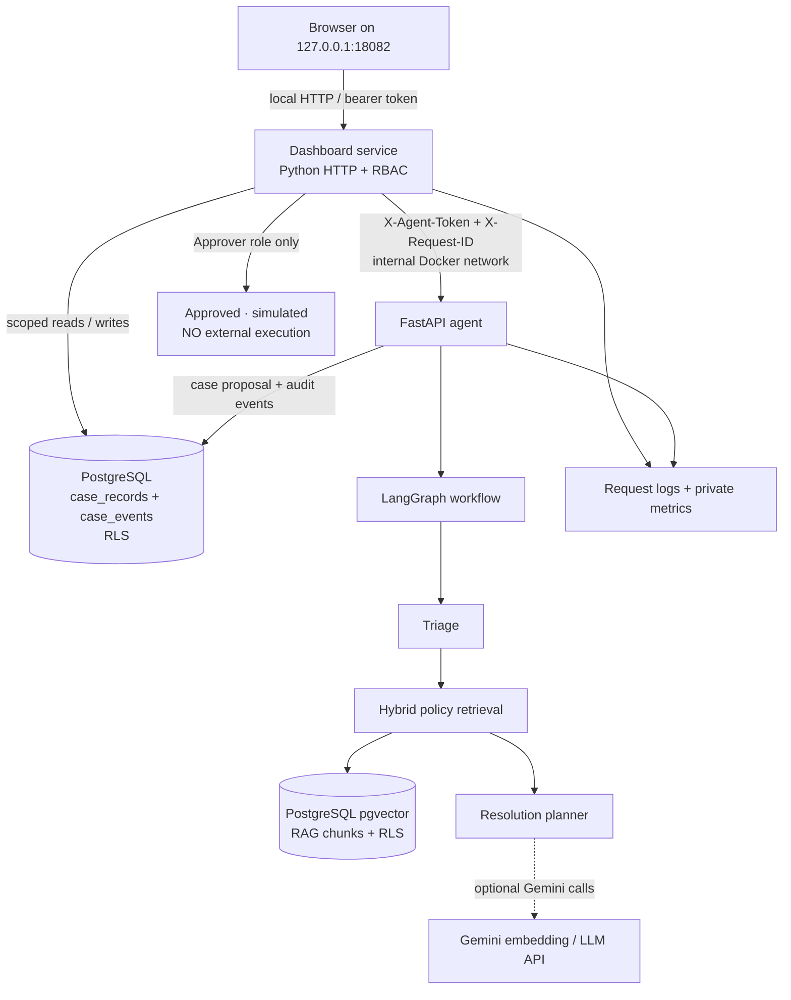

# ElyraOps AI — system architecture

**Scope:** verified local demonstration design, not a public production system. The diagram is a conceptual map of the running Phase 6 Compose topology; details can differ in the separate deterministic SQLite demo.

## Boundaries and sequence

1. **Browser to dashboard:** A local bearer token identifies a demo principal and its organization. Viewer, Analyst, Approver and Admin roles have distinct permissions. Tokens are demo-local; they are not OIDC identities.
2. **Dashboard to PostgreSQL:** The app sets tenant scope per transaction using a dedicated non-owner database role; `ENABLE` and `FORCE ROW LEVEL SECURITY` protect case/event records. A compromised application/database credential is not covered by this model.
3. **Dashboard to agent:** The dashboard forwards a bounded investigation request using an internal token and correlation ID. The FastAPI port is internal to the Compose network in the guarded deployment.
4. **Agent to policy index:** pgvector cosine similarity and PostgreSQL lexical search are combined with reciprocal rank fusion. Protected RAG retrieval uses tenant-scoped non-owner access and permits designated shared policy documents.
5. **Agent to Gemini:** With a configured key, embeddings and constrained LLM reasoning can be performed remotely. Synthetic data only; prompts may leave your Mac.
6. **Agent result to PostgreSQL:** Recommendations and timeline events are recorded, but no external actions execute. Human approval changes the internal demo status and appends audit events.
7. **Observability:** Request IDs, JSON logs and protected Prometheus-format endpoints help trace behavior locally. This is not a full production OpenTelemetry trace collector.

## Data and control plane

| Concern | Owner | Important distinction |
| --- | --- | --- |
| Synthetic cases and workflow timeline | PostgreSQL case/event tables | RLS under guarded mode; default offline demo may use SQLite |
| Policy chunks and embeddings | PostgreSQL + pgvector | RLS-protected RAG mode; shared documents permitted where configured |
| Agent execution | FastAPI + LangGraph | Proposed decisions, no external task execution |
| Access and permissions | Local token authorization | Role-scoped simulation, not enterprise SSO |
| Health/readiness/logging | Dashboard and agent | Readiness checks dependencies, health checks process liveness |
| Image/container CI | GitHub Actions | Disposable PostgreSQL + HTTP smoke do not replace full staged deployment |

## Deliberate limitations and future work

OIDC/MFA, canonical tenant IDs, managed secrets, outbound TLS reverse proxy, cloud deployment, persistent workflow checkpoints, production SLOs, backups/restore drills and independent security review are not delivered. Do not treat RLS test coverage or passing localhost CI as proof of production readiness.
